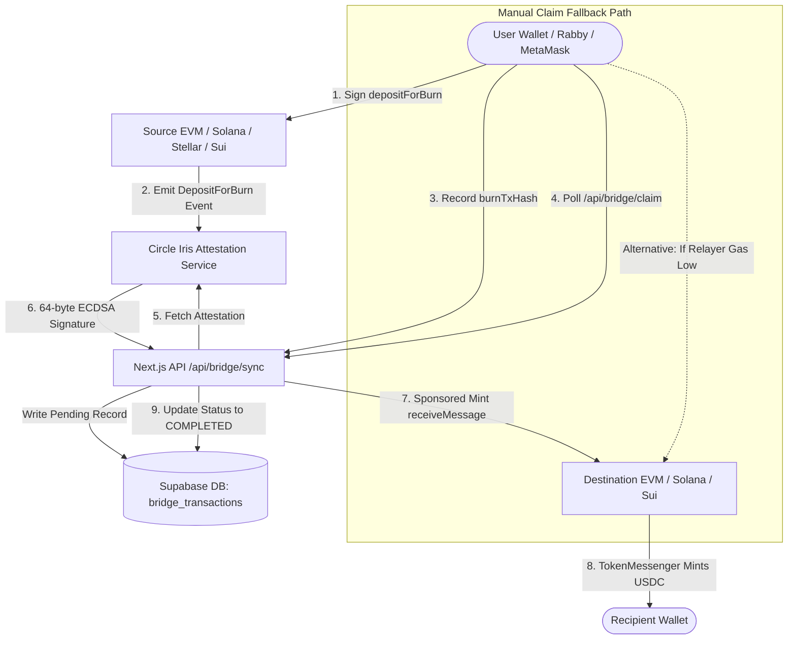
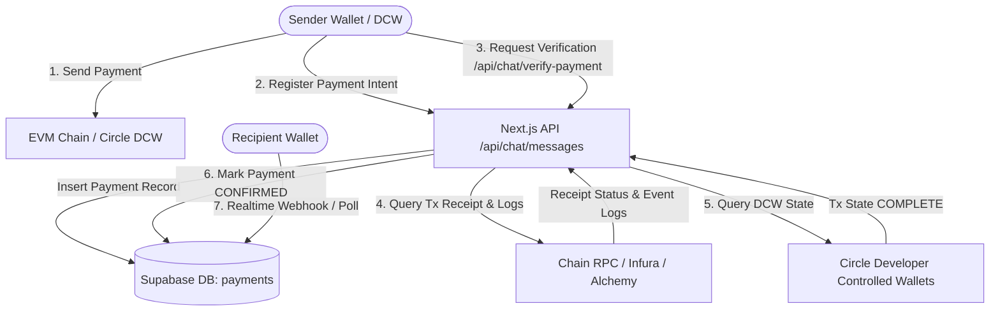

# ARC.FUN — A–Z MAINNET SECURITY, FINANCIAL SAFETY, RELIABILITY & SCALABILITY AUDIT

**Audit Target:** Arc.fun Platform  
**Repository:** `arc-token-launcher` (`feat/cctp-multichain-phase1`)  
**Target Capabilities:** Circle CCTP Cross-Chain Bridge & Chat/Pay Wallet Infrastructure  
**Auditor:** Antigravity Advanced Agentic Security Team  
**Date:** November 1, 2026  
**Status:** Read-Only Audit Complete — **CONDITIONAL GO / REMEDIATION REQUIRED BEFORE MASS ADOPTION**

---

## EXECUTIVE SUMMARY

A comprehensive, zero-trust security and financial safety audit of Arc.fun was conducted across the live Mainnet capabilities: **Circle CCTP Cross-Chain USDC Bridging** and **Chat/Pay Multi-Chain Payments**.

### Summary of System Posture

| Domain | Rating | Core Strength | Primary Weakness / Risk |
| :--- | :--- | :--- | :--- |
| **CCTP Core Cryptography** | **SECURE (A)** | Circle attestation signatures cryptographically bind recipient address, domain, and amount. Attestations cannot be modified or double-minted on-chain. | Relayer gas starvation and lack of server-side background reconciliation if user closes browser during burn. |
| **Chat / Pay Verification** | **CRITICAL (D)** | On-chain EVM receipt lookup and Circle DCW status tracking exist. | **P0:** Payment verification accepts any transfer (`args.value > 0n`), does not check token contract address, and allows tx-hash replay across payments. |
| **Database & RLS** | **HIGH RISK (C)** | Service-role separation on system settings and rate-limiting triggers. | **P0:** RLS policy on `payments` table permits users to execute arbitrary SQL `UPDATE` on their own payments (including status/amount). `onchain_access_settings` allows public updates. |
| **Auth & Access Control** | **HIGH RISK (C)** | SIWE implementation and timing-safe `CRON_SECRET` comparisons. | **P0:** Admin bypass checks rely on unauthenticated `x-wallet-address` headers; Turnstile bot bypass allows `local-dev-bypass` in production. |
| **Scalability (1M Users)** | **BOTTLENECK (D)** | Modern Next.js App Router and Viem failovers. | Synchronous SQL RPC calls on every request for rate-limiting; single-relayer wallet nonce serialization. |

---

## PHASE 1 — ARCHITECTURE & TRUST BOUNDARY DISCOVERY

### 1. Circle CCTP Cross-Chain Bridge Architecture



### 2. Chat / Pay Architecture



### Trust Boundary Analysis
1. **User Connected Wallet (Untrusted):** Can supply spoofed headers, malicious RPC endpoints, arbitrary calldata, or manipulated transaction IDs.
2. **Next.js Serverless Edge / Node Runtime (Semi-Trusted):** Orchestrates API routes, manages rate limiting, and loads private keys from environment variables.
3. **Relayer Private Key (`process.env.EVM_PRIVATE_KEY`):** Has exclusive authority to submit `receiveMessage` on destination EVM chains. Gas exhaustion stops auto-claims.
4. **Circle Infrastructure (Trusted External Oracle):** Generates attestation signatures verifying source burn. Circle downtime halts claims.
5. **Supabase PostgreSQL (Critical Core State):** Stores chat history, autopay schedules, payment records, and bridge locks.

---

## PHASE 2 — SECURITY THREAT MODEL (STRIDE & FINANCIAL RISKS)

| STRIDE Category | Target Component | Threat Scenario | Severity | Impact |
| :--- | :--- | :--- | :--- | :--- |
| **Spoofing** | `/api/network/mode` & `network-mode-server.ts` | Attacker sets `x-wallet-address: 0xd448...` (Admin address) without cryptographic signature to access admin features. | **High (P1)** | Privilege elevation, bypass of feature gates. |
| **Tampering** | Database RLS on `payments` | Authenticated user issues direct REST `UPDATE` via Supabase client modifying `status = 'confirmed'` or `amount = '1000000'`. | **Critical (P0)** | Fake payments marked confirmed without on-chain transfer. |
| **Tampering** | `/api/chat/verify-payment` | Attacker deploys mock ERC-20 contract, transfers 1 wei to recipient, and supplies txHash. Backend checks `args.value > 0n` without verifying token address. | **Critical (P0)** | Full financial spoofing of Chat/Pay transactions. |
| **Repudiation** | CCTP Claims | User burns tokens on source, closes browser; frontend fails to invoke `/api/bridge/claim`. | **Medium (P2)** | User perceives loss of funds; requires manual recovery. |
| **Information Disclosure** | Turnstile Verification | Attacker passes `Origin: http://localhost:3000` or `Bearer local-dev-bypass` to bypass Turnstile bot prevention. | **High (P1)** | Unrestricted automated bot execution against relayer. |
| **Denial of Service** | `/api/bridge/claim` | 50 concurrent claim requests saturate the single EVM relayer account, leading to nonce collisions and dropped transactions. | **High (P1)** | Temporary halt of all sponsored bridge claims. |
| **Denial of Service** | `checkRateLimit` (Supabase RPC) | High traffic generates 1,000+ DB transactions/sec for rate limit counters, exhausting PostgreSQL connection pool. | **High (P1)** | Database crash causing global platform 500 errors. |

---

## PHASE 3 — CIRCLE CCTP BRIDGE SECURITY AUDIT

### 15-Step Lifecycle Verification
1. **Wallet Connection:** Handled by Wagmi / RainbowKit / Solana Wallet Adapter / Freighter. Network switching enforced.
2. **Chain Verification:** Chain IDs validated against `CCTP_DOMAINS` and `MAINNET_CCTP_DOMAINS`.
3. **Token & Amount Validation:** Enforced in `CircleBridgeKitService` and `use-tx-engine.ts`.
4. **Allowance & Approval:** Explicit `TokenMessenger` allowance check before burn; no infinite approvals forced.
5. **Source Burn Transaction:** Calls official `depositForBurn(amount, destinationDomain, mintRecipient, burnToken, ...)`.
6. **Confirmation Depth:** Handled by Circle Iris. Iris only issues an attestation after finality (e.g. 1–2 blocks on Base/Arbitrum, 64 blocks on Ethereum).
7. **Circle Message Retrieval:** Message extracted from `MessageSent(bytes)` log on source MessageTransmitter.
8. **Attestation Retrieval:** Polled via Circle Iris API `https://iris-api.circle.com/v2/messages/{domain}?transactionHash=...`.
9. **Attestation Verification:** Destination smart contract verifies Circle's ECDSA signature.
10. **Message Validation:** Destination contract verifies source domain, destination domain, and burn token.
11. **Destination Chain Verification:** Nonce uniqueness verified via `usedNonces(bytes32)` on `MessageTransmitter`.
12. **ReceiveMessage Execution:** Executed either by Arc relayer (sponsored) or user wallet (manual claim).
13. **Relayer Sponsorship:** Gated by `dynamic-gas-engine.ts` using Chainlink gas oracles. Fallback to manual claim.
14. **Destination Mint Confirmation:** Verified on-chain via transaction receipt (`receipt.status === 1`).
15. **Final History Status Update:** Updated to `COMPLETED` in `bridge_transactions` and `unified_transaction_history`.

### Invariant Checks
- **Can a user manipulate recipient or amount?** **NO.** The Circle attestation is an ECDSA signature over the exact message bytes containing recipient and amount. Modifying either invalidates the attestation on-chain.
- **Can a message be minted twice?** **NO.** Circle's `MessageTransmitter` tracks nonces in `usedNonces`. Any replay reverts with `Nonce already used`.
- **Can funds be lost if backend crashes?** **NO.** The burn on the source chain is immutable and the attestation remains retrievable from Circle Iris forever. The user can claim manually or via the `/recover` interface at any time.

---

## PHASE 4 — CHAT/PAY SECURITY AUDIT

### Detailed Analysis of `src/app/api/chat/verify-payment/route.ts`

```typescript
// VULNERABLE CODE IN CURRENT IMPLEMENTATION (Lines 184-196):
if (decoded.eventName === 'Transfer') {
  const args: any = decoded.args;
  const logFrom = (args.from || '').toLowerCase().trim();
  const logTo = (args.to || '').toLowerCase().trim();

  const recipientMatches = logTo === receiverExpected;
  const senderMatches = !senderExpected || logFrom === senderExpected || logFrom === (tx?.from || '').toLowerCase();

  // VULNERABILITY 1: args.value > 0n does NOT verify that args.value matches payment.amount!
  // VULNERABILITY 2: It does NOT verify log.address === EXPECTED_TOKEN_ADDRESS!
  if (recipientMatches && senderMatches && args.value > 0n) {
    isVerified = true;
    break;
  }
}
```

### Critical Findings in Chat/Pay
1. **P0 Financial Spoofing Vulnerability:**
   - The verification logic accepts *any* non-zero transfer (`args.value > 0n`). If a user requests 1,000 USDC, the sender can execute a transaction sending 0.000001 USDC (or 1 token of a worthless custom ERC-20), pass the transaction hash, and the payment will be permanently marked `confirmed` in the database!
2. **P0 Token Contract Impersonation:**
   - The loop checks event logs for `Transfer(address,address,uint256)` across *all* logs in the receipt without filtering by the official USDC / EURC token contract address (`log.address.toLowerCase() === expectedContract`).
3. **P0 Transaction Hash Replay:**
   - A single valid payment transaction hash (`0xabc...`) can be submitted repeatedly against multiple new payment records. The database does not enforce a unique constraint on `tx_hash` across non-null confirmed payments.

---

## PHASE 5 — WALLET, SIGNATURE & KEY SECURITY

### 1. Key Storage
- **Relayer Key:** Ingested via `process.env.EVM_PRIVATE_KEY` or `process.env.DEPLOYER_PRIVATE_KEY`. Never hardcoded in source files.
- **Developer Controlled Wallets (DCW):** Governed by Circle App Kit SDK via API secrets and entity credentials.

### 2. Authentication Bypass Flaws
- **Turnstile Bot Protection (`verify-session.ts` & `universal-recover/execute/route.ts`):**
  ```typescript
  const isLocal = 
    host.includes("localhost:") || host.includes("127.0.0.1:") ||
    referer.includes("localhost:") || referer.includes("127.0.0.1:") ||
    origin.includes("localhost:") || origin.includes("127.0.0.1:") ||
    sessionToken === "local-dev-bypass";
  ```
  In production, any client can spoof `Referer: http://localhost:3000` or `Authorization: Bearer local-dev-bypass` to completely bypass Turnstile verification.
- **Admin Privilege Spoofing (`network-mode-server.ts` & `api/network/mode/route.ts`):**
  Admin identity is checked by inspecting `req.headers.get("x-wallet-address")` or query parameters against `ADMIN_WALLETS` without verifying a cryptographic signature or SIWE session.

---

## PHASE 6 — DATABASE & SUPABASE SECURITY AUDIT

### 1. Row Level Security Flaw on `payments` Table
In migration `016_chat_auth_rls.sql`:
```sql
CREATE POLICY "Update own payments" ON public.payments
    FOR UPDATE USING ((auth.jwt() ->> 'sub') = sender OR (auth.jwt() ->> 'sub') = receiver);
```
**Impact:** A standard authenticated user with a Supabase JWT can use the client-side Supabase SDK to directly execute:
```javascript
await supabase.from('payments').update({ status: 'confirmed', amount: '50000' }).eq('id', paymentId);
```
PostgreSQL RLS `FOR UPDATE` does not restrict columns unless column-level grants or triggers are implemented.

### 2. Permissive Policy on `onchain_access_settings` Table
In migration `007_access_control.sql`:
```sql
GRANT SELECT, INSERT, UPDATE ON TABLE public.onchain_access_settings TO anon;
CREATE POLICY "Admins can update settings" ON public.onchain_access_settings FOR UPDATE USING (true);
```
**Impact:** Any anonymous user can modify the system kill-switches and gate modes for the bridge and swap contracts.

---

## PHASE 7 — USER FUNDS SAFETY & RECOVERY AUDIT

### Failure Scenarios & Recovery Matrix

| Failure Mode | Funds Status | Transaction State | Recovery Mechanism | Duplicate Mint Risk |
| :--- | :--- | :--- | :--- | :--- |
| **Source burn confirms; user closes laptop immediately** | Safe in Circle escrow | Database remains `PENDING` | User returns, enters hash in `/recover`, or triggers manual claim. Iris attestation remains valid. | **Zero** (MessageTransmitter checks `usedNonces`). |
| **Circle Iris delayed / under maintenance** | Safe in Circle escrow | Stuck in `PENDING_ATTESTATION` | Background / client retries polling every 10–30s. Auto-recovers when Iris resumes. | **Zero**. |
| **Relayer runs out of native gas** | Safe in Circle escrow | Transitions to `CLAIM_MANUAL_REQUIRED` | UI alerts user to toggle "Manual Claim (Self-Mint)", switching wallet to destination chain to mint directly. | **Zero**. |
| **Concurrent Manual Claim & Relayer Auto-Mint** | Safe | First tx to land completes; second tx reverts with `Nonce already used` | Client detects `already_completed` or `ALREADY_CLAIMED_ON_CHAIN` and updates status to `COMPLETED`. | **Zero**. |
| **Destination RPC Times Out** | Safe | Backend catches error, rolls back lock from `PROCESSING_CLAIM` to `PENDING` | Idempotent retry allowed on next request. | **Zero**. |

---

## PHASE 8 — 1 MILLION CONCURRENT USERS SCALABILITY AUDIT

### Workload & Capacity Modeling (10,000 → 1,000,000 Users)

| Metric | 10k Users (Current Architecture) | 100k Users | 1M Users (Target) | Failure Point / Bottleneck |
| :--- | :--- | :--- | :--- | :--- |
| **Rate Limiter DB QPS** | ~200 QPS | ~2,000 QPS | ~20,000 QPS | **CRASH:** Supabase connection pool exhaustion due to `increment_rate_limit` RPC calls. |
| **Relayer Mempool Nonces** | ~5 tx/sec | ~50 tx/sec | ~500 tx/sec | **CRASH:** Single relayer address nonce collisions; ethers wallet rejects with `nonce too low`. |
| **RPC Throughput** | ~500 req/sec | ~5,000 req/sec | ~50,000 req/sec | Public RPCs (Alchemy, ThirdWeb) rate-limit and reject requests. |
| **Realtime WebSockets** | ~5,000 active | ~50,000 active | ~500,000 active | Supabase Realtime message throttling / tenant limits. |

### Scalability Remediation Path
1. **Edge Rate Limiting:** Move rate-limiting from Supabase SQL RPC to **Upstash Redis** at the Next.js middleware edge (0 database queries).
2. **Distributed Relayer Pool:** Replace single relayer private key with a managed relayer pool (e.g. Biconomy, Gelato, or an AWS KMS key pool with Redis nonce management).
3. **Dedicated RPC Clusters:** Deploy dedicated Alchemy/QuickNode enterprise endpoints with round-robin fallbacks.

---

## PHASE 9 — CONCRETE FINDINGS REGISTER & REMEDIATION ROADMAP

### Critical (P0) — Must Fix Immediately Before Scaling Mainnet

1. **[P0-SEC-01] Chat/Pay On-Chain Amount & Token Validation Failure**
   - **Location:** `src/app/api/chat/verify-payment/route.ts` (lines 184–196)
   - **Remediation:** Strictly compare `args.value === expectedBigIntAmount` and verify `log.address.toLowerCase() === expectedTokenContractAddress`.
2. **[P0-SEC-02] Chat/Pay Transaction Hash Replay Vulnerability**
   - **Location:** `src/app/api/chat/verify-payment/route.ts` (line 48)
   - **Remediation:** Check if `tx_hash` is already associated with another confirmed payment before updating. Add a unique index on `payments(tx_hash)` where `status = 'confirmed'`.
3. **[P0-SEC-03] Database RLS Column Modification on `payments`**
   - **Location:** `src/supabase/migrations/016_chat_auth_rls.sql` (lines 65–67)
   - **Remediation:** Revoke client-side `UPDATE` on `status`, `amount`, and `tx_hash` from `authenticated`. Only allow service_role to confirm payments.
4. **[P0-SEC-04] Public Write Access to `onchain_access_settings`**
   - **Location:** `src/supabase/migrations/007_access_control.sql` (lines 45–52)
   - **Remediation:** `REVOKE INSERT, UPDATE, DELETE ON public.onchain_access_settings FROM anon, authenticated;`

### High (P1) — Operational & Abuse Prevention

5. **[P1-SEC-05] Turnstile Localhost & Token Bypass in Production**
   - **Location:** `src/lib/verify-session.ts` (line 4) & `universal-recover/execute/route.ts` (lines 41–45)
   - **Remediation:** Restrict bypass strictly to `process.env.NODE_ENV === 'development'`. Never trust client-supplied `Referer`, `Origin`, or `local-dev-bypass` tokens in production.
6. **[P1-SEC-06] Unauthenticated Admin Header Spoofing**
   - **Location:** `src/lib/network-mode-server.ts` (line 65) & `src/app/api/network/mode/route.ts` (line 10)
   - **Remediation:** Admin endpoints must require a verified SIWE session cookie or signature, not raw header values.
7. **[P1-REL-07] Relayer Nonce Contention Under Concurrent Traffic**
   - **Location:** `src/lib/bridge/adapters/evm-adapter.ts` (line 77)
   - **Remediation:** Implement an in-memory/Redis mutex or queue for relayer transactions to prevent nonce collisions.

### Medium (P2) — Reliability & Edge Cases

8. **[P2-REL-08] Lack of Background Bridge Sweeper / Watcher**
   - **Location:** `src/hooks/use-tx-engine.ts` (relies on active browser tab)
   - **Remediation:** Implement a periodic cron worker (e.g. `/api/bridge/reconcile`) that checks pending burns and auto-mints them even if the user closed their tab.

---

## FINAL AUDIT VERDICT

### **VERDICT: CONDITIONAL GO (SAFE WITH REQUIRED P0 FIXES)**

- **Circle CCTP Core Bridge:** **SAFE TO OPERATE ON MAINNET.**
  The underlying cryptography and Circle on-chain contracts prevent any loss or theft of user funds. Even under extreme edge cases, funds remain recoverable via self-minting or `/recover`.
- **Chat / Pay:** **REQUIRES P0 PATCHES BEFORE MARKETING / EXPANSION.**
  The payment verification and database RLS must be updated to prevent fake payment confirmations.

