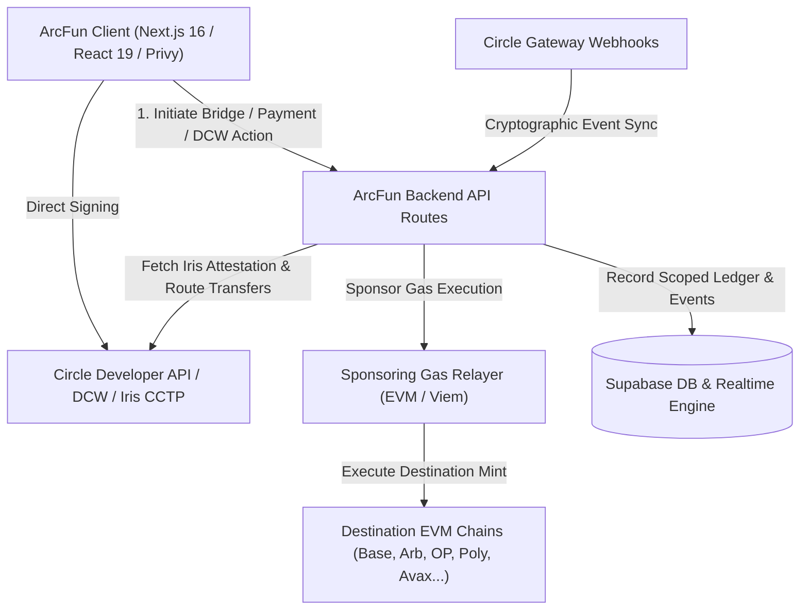

# ArcFun — Circle Submission Platform

**Live Application:** [https://www.thearcfun.xyz/](https://www.thearcfun.xyz/)

> Next-Generation Cross-Chain USDC Settlement, Instant Chat & Pay, Universal Developer-Controlled Wallets & Circle Gateway Protocol on Arc Network & EVM Chains.

ArcFun is a comprehensive Web3 financial application engineered for seamless multi-chain USDC liquidity, powered by Circle CCTP V2, Circle Bridge Kit, Circle Developer-Controlled Wallets (DCW), and Circle Gateway. Available in production at [thearcfun.xyz](https://www.thearcfun.xyz/).

---

## The 4 Core Active Modules

ArcFun provides four interconnected, production-ready modules built specifically on Circle's cross-chain architecture:

### 1. Circle CCTP V2 Cross-Chain Bridge
- **Circle CCTP V2 Native Integration:** Fast, trust-minimized USDC cross-chain transfers between Arc Network and 9+ major EVM chains (Arbitrum, Base, Optimism, Polygon, Avalanche, Ink, Unichain, Linea, and Ethereum Sepolia).
- **Circle Bridge Kit Integration:** High-performance client-side and server-side orchestration powered by the official `@circle-fin/bridge-kit` SDK.
- **Backend Gas Fee Sponsorship:** Sponsoring relayer allows recipient execution on destination chains without requiring native gas tokens (sponsored minting).
- **Manual Wallet Claim Fallback:** Complete self-custodial safety; if a relayer is congested or offline, users can claim destination mints directly via their connected Web3 wallet.
- **Universal Transaction History & Scoping:** Comprehensive transaction tracker, indexing on-chain message bytes, attestations, and explorer receipts across all supported domains.

### 2. Chat & Pay with AutoPay
- **Social On-Chain Payments:** Send and receive USDC directly inside real-time peer-to-peer and group chats.
- **AutoPay Smart Execution:** Programmable recurring and conditional micro-transfers with customizable cooldowns and transaction limits.
- **Circle Developer-Controlled Wallets (DCW):** Non-custodial biometric/passkey-secured execution and user-controlled wallet provisioning.
- **Payment Verification:** Real-time on-chain verification, cryptographic signature validation, and instant database settlement.

### 3. ArcFun Wallet
- **Universal Web3 Wallet Management:** Seamless multi-chain connection via Privy, WebAuthn Passkeys, and Wagmi/Viem.
- **Multi-Chain Transaction Signing:** Native support for EVM chains, Solana, and Arc Network.
- **Security Center:** Active session management, spending limit approvals, cryptographic security checks, and hardware key recovery.

### 4. Circle Gateway
- **Unified Multi-Chain Balance Aggregation:** Consolidate and monitor user USDC liquidity across disparate rollups and networks into a unified dashboard.
- **Cross-Chain Liquidity Routing:** Seamless rebalancing and gas-optimized deposits.
- **Idempotent Webhook Processing:** Secure asynchronous settlement tracking powered by Circle Webhooks with replay attack prevention and signature verification.

---

## Architecture & Transaction Flow



---

## Supported Networks & CCTP Domains

| Network | Chain ID | CCTP Domain | Native Asset | Support Mode |
| :--- | :--- | :--- | :--- | :--- |
| **Arc Mainnet / Testnet** | 5042001 / 5042002 | — | USDC | Native Core |
| **Ethereum** | 1 / 11155111 | 0 | ETH | Mainnet & Testnet |
| **Arbitrum** | 42161 / 421614 | 3 | ETH | Mainnet & Testnet |
| **Base** | 8453 / 84532 | 6 | ETH | Mainnet & Testnet |
| **Optimism** | 10 / 11155420 | 2 | ETH | Mainnet & Testnet |
| **Polygon PoS** | 137 / 80002 | 7 | POL | Mainnet & Testnet |
| **Avalanche** | 43114 / 43113 | 1 | AVAX | Mainnet & Testnet |
| **Ink** | 57073 / 763373 | — | ETH | Mainnet & Testnet |
| **Unichain** | 130 / 1301 | 10 | ETH | Mainnet & Testnet |
| **Linea** | 59144 / 59141 | — | ETH | Mainnet & Testnet |

---

## Tech Stack

- **Frontend & Fullstack Framework:** Next.js 16 (App Router), React 19, Tailwind CSS, Framer Motion, Zustand.
- **Web3 & Circle Tooling:** `@circle-fin/bridge-kit`, `@circle-fin/user-controlled-wallets`, Privy SDK, Viem v2, Wagmi v2, Ethers v6.
- **Database & Realtime Backend:** Supabase PostgreSQL with strict Row Level Security (RLS) policies and Realtime event subscriptions.
- **Security & Infrastructure:** EIP-712 typed signing, Cloudflare protection, idempotent webhook replay guards, and gas-sponsored relayer clustering.

---

## Local Development Setup

### 1. Prerequisites
- **Node.js:** `v20.x` or `v22.x` (LTS recommended)
- **Package Manager:** `npm` (v10+)
- **Git**

### 2. Clone Repository
```bash
git clone https://github.com/zaxcrypto/arcfun-studiobuild.git
cd arcfun-studiobuild
```

### 3. Install Dependencies
```bash
npm install --legacy-peer-deps
```

### 4. Configure Environment Variables
Create a local `.env.local` file using the required names listed below:
```bash
cp .env.example .env.local
```

### 5. Start Development Server
```bash
npm run dev
```
Open http://localhost:3000 to view the application.

---

## Environment Variables (By Name Only)

Configure the following variables in your hosting environment (do not expose private keys or secrets):

### Circle Developer & DCW Configuration
- `CIRCLE_API_KEY`: Circle Developer Portal API key.
- `CIRCLE_ENTITY_SECRET`: 32-byte hex encryption secret for DCW operations.
- `NEXT_PUBLIC_CIRCLE_IRIS_API_URL`: Iris attestation endpoint for CCTP V2.

### Privy & Authentication
- `NEXT_PUBLIC_PRIVY_APP_ID`: Privy application identifier.
- `PRIVY_APP_SECRET`: Privy backend secret.

### Supabase (Database & Realtime)
- `NEXT_PUBLIC_SUPABASE_URL`: Supabase project URL.
- `NEXT_PUBLIC_SUPABASE_ANON_KEY`: Supabase client-safe anonymous key.
- `SUPABASE_SERVICE_ROLE_KEY`: Supabase privileged service-role key.

### Gas Sponsorship & Relayer
- `RELAYER_PRIVATE_KEY` / `CCTP_RELAYER_PRIVATE_KEY`: Sponsoring gas wallet private key.
- `CRON_SECRET`: Bearer token for authenticating scheduled reconciliation tasks.

### Multi-Chain RPC Endpoints
- `NEXT_PUBLIC_ARCFUN_MAINNET_ENABLED`: Flag (`true` / `false`) toggling Mainnet or Testnet modes.
- `NEXT_PUBLIC_ARC_MAINNET_RPC_URL` / `NEXT_PUBLIC_ARC_RPC`
- `NEXT_PUBLIC_BASE_MAINNET_RPC_URL` / `NEXT_PUBLIC_BASE_SEPOLIA_RPC`
- `NEXT_PUBLIC_ARB_MAINNET_RPC_URL` / `NEXT_PUBLIC_ARBITRUM_SEPOLIA_RPC`
- `NEXT_PUBLIC_OP_MAINNET_RPC_URL` / `NEXT_PUBLIC_OPTIMISM_SEPOLIA_RPC`
- `NEXT_PUBLIC_POLYGON_MAINNET_RPC_URL`
- `NEXT_PUBLIC_AVALANCHE_MAINNET_RPC_URL`
- `NEXT_PUBLIC_INK_MAINNET_RPC_URL`
- `NEXT_PUBLIC_UNICHAIN_MAINNET_RPC_URL`
- `NEXT_PUBLIC_LINEA_MAINNET_RPC_URL`

---

## Testing & Verification

Run the automated test suites:
```bash
# Run unit & integration tests
npm test

# Run CCTP and Bridge Kit tests
npx jest src/__tests__/bridge-history-production.test.ts src/__tests__/cctp-gas-recovery-audit.test.ts

# Production build check
npm run build
```

---

## Security & Disclosures

ArcFun adheres to defense-in-depth security principles:
- **EIP-712 & Replay Guards:** All off-chain intent verifications use domain-separated cryptographic hashing.
- **Idempotent Webhooks:** Circle Gateway events verify timestamps and RSA signatures before committing transactions.
- **Non-Custodial Architecture:** Keys are protected via Circle DCW and Privy hardware/passkey abstractions.
